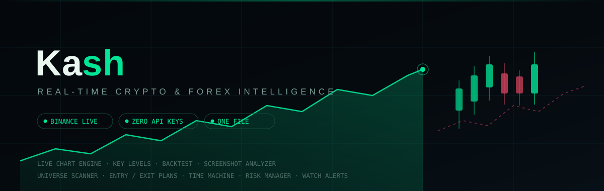
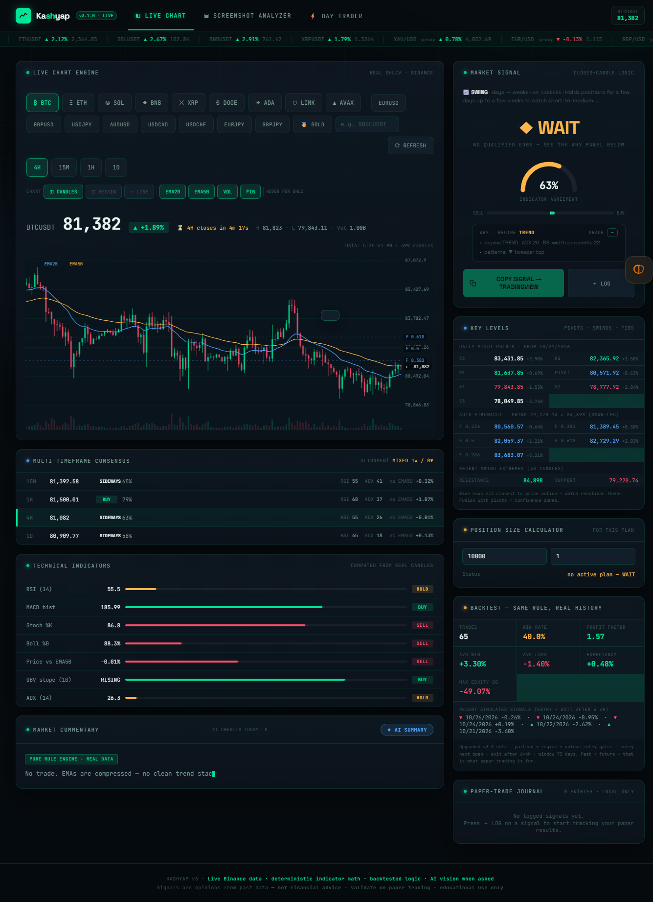
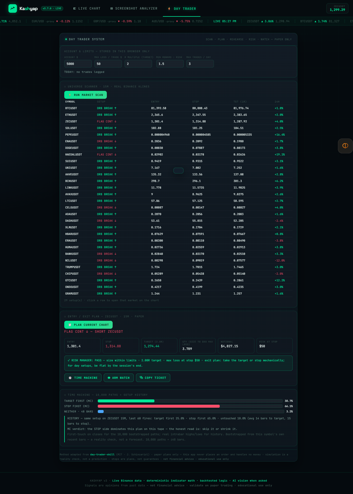
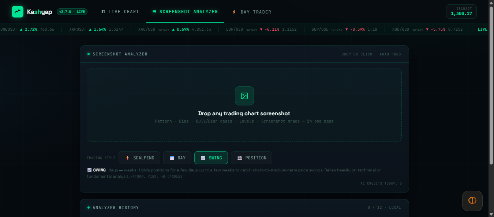

<div align="center">



# 📈 Kash

**One HTML file. Real wire data. Zero API keys. Zero builds.**

*Crypto & forex market intelligence — live chart engine, deterministic indicator math,
a backtested rule engine, Gemini-vision screenshot analysis and a full day-trading
methodology that rehearses before it recommends.*

[](#-quick-start)
[](#-license)
[](#-data--privacy)
[](#-quick-start)
[](#-data--privacy)
[](#-the-fine-print)

</div>

---

## 🧭 What is Kash?

Kash is a **single-file trading dashboard** — `kash-v3.html` — that runs straight from disk
(double-click it) or from any static server. No install, no account, no bundler, no framework,
no API key signup. It loads **real quotes from Binance's public API** for crypto and a
**multi-route ladder** (Yahoo → relays → ECB daily → Binance token mirrors) for forex, then runs
the same indicator math a spreadsheet would: transparent, deterministic, inspectable.

Three views, one nav:

| | |
| --- | --- |
| **◧ LIVE CHART** | Candle engine + indicators + signals + backtest + levels + sizer |
| **▤ SCREENSHOT ANALYZER** | Drop any chart screenshot → structured Gemini vision read |
| **⚡ DAY TRADER** | Scan the whole market → plan the trade → rehearse the odds → watch the levels |

---

## 📡 Feature Map

### ◧ Live Chart Engine

| | Feature | What it does |
| --- | --- | --- |
| ⚡ | **9 crypto pairs + 8 FX majors + GOLD** | BTC, ETH, SOL, BNB, XRP, DOGE, ADA, LINK, AVAX · EURUSD, GBPUSD, USDJPY, AUDUSD, USDCAD, USDCHF, EURJPY, GBPJPY · 🥇 XAU/USD — plus a **custom pair input** for any Binance symbol (`e.g. DOGEUSDT`) |
| 🕒 | **4 timeframes** | 15M / 1H / 4H / 1D — the bars state the truth about their own interval |
| 📊 | **Chart types** | Candles · Heikin-Ashi · Line, with live EMA20/EMA50 overlays, volume bars, Fibonacci levels and hover-for-OHLC readout |
| 🧮 | **7 real indicators** | RSI(14) · MACD histogram · Stochastic %K · Bollinger %B · price-vs-EMA50 · OBV slope · ADX(14) — each with its own bar and verdict |
| 💹 | **Market Signal** | BUY / SELL / WAIT from closed-candle logic only — never the forming bar — plus an **indicator-agreement gauge** and a **WHY panel**: regime (trend/range), grade, ADX, BB-width percentile, candle patterns detected |
| 🧩 | **Multi-timeframe consensus** | The same symbol priced across 15M/1H/4H/1D with each row's regime, RSI, ADX and EMA drift — alignment graded in one line (MIXED / BULL / BEAR) |
| 🎯 | **Key Levels** | Daily pivot points (R3 → S3), auto-Fibonacci of the latest swing leg, recent swing extremes with a blue-confluence note — reaction zones, not promises |
| ⚖️ | **Position Size Calculator** | Account × risk units → position size and status for the plan on the chart |
| 📈 | **Backtest — same rule, real history** | The live rule walked across the symbol's own candles: trades, win rate, profit factor, avg win/loss, expectancy, max drawdown, and the most recent simulated signals with dates |
| 📰 | **Market Commentary** | A pure rule-engine narrative typed live (no trade, EMAs compressed…) with an optional **✦ AI SUMMARY** pass |

### 🔁 The FX Speed Kit (v3.6)

| | Feature | What it does |
| --- | --- | --- |
| 🏁 | **Express-first loads** | Two hosts raced in parallel from the first millisecond — FX answers in ~1s, not 10s |
| 🪞 | **Token mirrors** | GOLD/EUR/GBP/AUD pairs also served through Binance token proxies (PAXG-style) when Yahoo is slow or blocked |
| 🏦 | **ECB daily fallback** | Other fiat pairs degrade to the ECB daily feed rather than a fake price |
| 🧠 | **Persistent memo** | Last-good series stored in `localStorage` (5-minute freshness window) and quietly healed in the background by recovery probes |
| 🏷️ | **Honest route flags** | The banner says which feed actually served the data — YAHOO, TOKEN PROXY, or ECB — never a wrong label |

### 🔴 Ticker Tape (real wire, no fakes)

- Live chips pulled from Binance `/ticker/24hr` (crypto) and Yahoo spot (FX, with per-item token fallback)
- Failed or uncovered pairs are **omitted or marked `·proxy`** — the tape never invents a number
- A **LIVE HH:MM** clock chip, ~45s refresh, and a repaint guard: if a poll fails, the previous honest paint stays

### ▤ Screenshot Analyzer

- Drop or click → any trading screenshot → **one Gemini pass** → pattern, bias, bull/bear cases, levels and a screenshot grade
- Auto-runs on drop; re-run anytime; every analysis kept in **local history (12 slots)**
- All key-prompt UI removed — bring your own key in the source, or run without AI

---

## 🖼 Screenshots

### ◧ Live Chart — the full engine



*Candle engine with EMA overlays and Fib levels · 7-indicator table · BUY/SELL/WAIT signal with WHY panel · daily pivots + auto-Fibs · position sizer · real-history backtest · paper-trade journal.*

### ⚡ Day Trader System — scan, plan, rehearse



*Top-44 volume universe scanned for setups → a SHORT plan sized to a $50 max loss, risk manager PASS → the Time Machine replaying 10,000 bootstrapped paths plus 60 historical fires of the same setup.*

### ▤ Screenshot Analyzer — drop zone



*Any screenshot from any platform, any timeframe — one pass, structured verdict.*

---

## ⚡ Day Trader System — the methodology

Adapted from [`jakeschincariol/day-trader-skill`](https://github.com/jakeschincariol/day-trader-skill) (MIT — thank you, Jake) and ported into
the dashboard's own candle engine. One shared detector decides **everything** — scanner rows,
final plans, and every historical replay — so what you scan is what you rehearse.

| Module | What it does |
| --- | --- |
| **① Universe Scanner** | Pulls Binance's full 24h ticker list, ranks the top-44 USDT pairs by quoted volume, junk-filters the stables and leveraged tokens, then scans 15m klines in polite waves for three setups: **opening-range breakouts** (first 4 closed bars of the UTC session), **tight-flag continuations** after an impulse leg, and **RSI bounce/fades** at extremes |
| **② Entry / Exit Planner** | Detects the active setup on the chart you're watching, sizes it honestly — **qty = max-loss ÷ (entry − stop)** — targets your R-multiple, and writes a mechanical exit plan: take the target or stop, no discretion |
| **⚖️ Risk Manager** | The discipline layer: **PASS/BLOCK with reasons** — max-loss capped at 5% of account, reward:risk floored (default 1.5×), notional capped at account, daily trade cap, daily loss cap (6%) — fix the number or skip the trade |
| **🕐 Time Machine** | Before risking a dollar: the plan replayed **10,000×** with returns bootstrapped from *this symbol's own candles*, plus every historical fire of the same setup on this timeframe (real intrabar highs/lows first-touch) — honest odds, coin-flips included, with a verdict line in plain language |
| **⧉ Paper Ticket** | One click copies the full bracket — entry, stop, target, qty, notional, max loss — as text you place yourself. **This app never places an order** |
| **◉ Watch Alerts** | Arms the plan at every 5s live tick: toast + WebAudio beep (browser notification if granted) when STOP or TARGET is crossed, with the outcome auto-logged as paper WIN/LOSS — runs while the planned market is the loaded chart |

**What is intentionally *not* here (honesty by omission):** broker integration (orders), a news
feed (no reliable free wire), SEC/earnings and politician-trade trackers (US-stock-specific).
The dashboard would rather show nothing than fake something.

---

## 🔒 Data & Privacy

- **No API keys needed** — Binance public endpoints, Yahoo public charts, ECB daily reference rates
- **No accounts, no telemetry, no server calls home** — the file is the whole app
- **localStorage only** — FX memo, analyzer history, journal, day-trader log and limits stay in your browser
- **Closed-candle honesty** — signals and backtests are computed from candles that have fully closed; the forming bar is never part of a verdict
- **Every degradation is labeled** — token proxies, ECB daily, cached heals all say what they are

---

## 🚀 Quick Start

1. **Download** [`kash-v3.html`](kash-v3.html)
2. **Double-click it.** That's the whole setup — it runs from `file://` with the FX speed kit intact.
3. *(Optional)* serve it locally if you prefer a clean origin:

```bash
python -m http.server 8910
# then open http://127.0.0.1:8910/kash-v3.html
```

> **First load?** The scanner and tape pull real wire quotes on demand — give them a few seconds
> on a cold network. Everything else is instant.

---

## 📜 The Fine Print

- **Not financial advice.** Nothing in Kash is a recommendation to buy or sell anything.
- **Signals are opinions from past data.** Backtests and the Time Machine replay what *already
  happened* on this tape — a reality check, not a forecast. Past behavior ≠ future results.
- **Stops are plans, not guarantees.** Gaps, slippage and illiquidity can blow through any level.
- **Simulation ≠ prediction** — and the bootstrap draws from a small sample of recent bars.
- **No orders are ever placed.** There is no broker connection, no wallet, no money handling.
- **Educational use only.** Validate on paper trading first; you are the risk manager of record.

---

## 🙏 Credits

- **[day-trader-skill](https://github.com/jakeschincariol/day-trader-skill)** by Jake Schincariol — MIT — the scanner, planner, Time Machine, risk manager, sizer and watch concepts adapted here
- **[Binance](https://binance-docs.github.io/apidocs/spot/en/)** public market API — crypto candles, tickers, ticker tape
- **[Yahoo Finance](https://query1.finance.yahoo.com/)** public chart endpoints — FX spot series
- **[European Central Bank](https://www.ecb.europa.eu/stats/eurofxref/eurofxref-daily.xml)** — daily fiat reference rates
- **[Lenis](https://github.com/darkroomengineering/lenis)** + **[Motion](https://motion.dev)** via CDN — motion, with pure-CSS fallback when offline

---

<div align="center">

**Ka**sh — *paper plans only · discipline is the edge · not financial advice*

</div>
